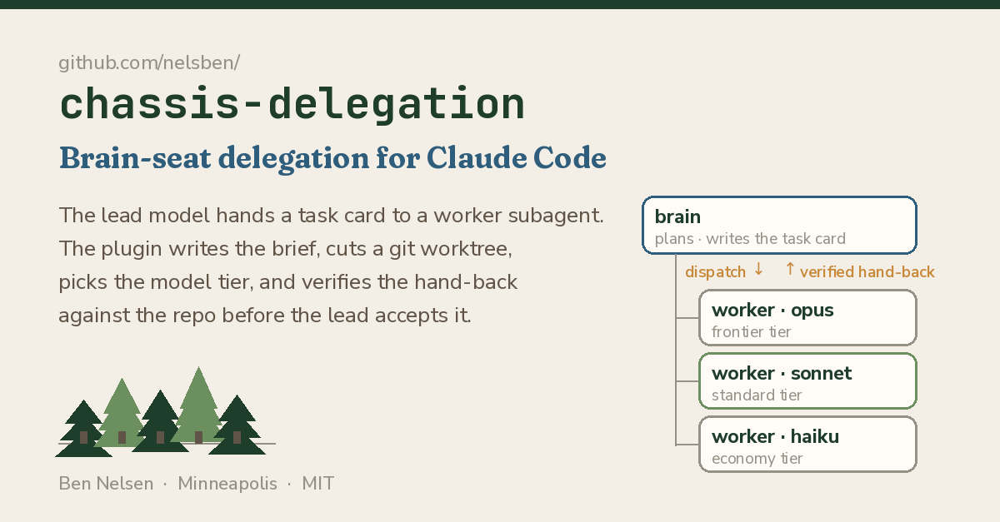
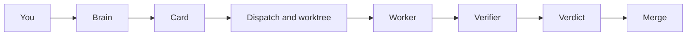

# chassis-delegation

**Delegate coding tasks to verified Claude workers.**



chassis-delegation is a Claude Code mod for developers who want to hand off several coding tasks at once without losing track of what comes back. You describe a task; Claude writes it up as a task card, and one dispatch call turns the card into a git worktree and a worker on the model its tier names. When the worker hands back, the mod checks its report against git, gives you one verdict line, and shows what is running and what it costs.

## How it works

*Flowchart: you describe a task, the brain writes a card, dispatch makes a worktree and a worker, the verifier checks the hand-back against git, the verdict leads to a merge.*



The flow in four diagrams, with what the verifier checks: [docs/how-it-works.md](docs/how-it-works.md).

## Evidence

- 689 tasks across six repos, from 3 to 20 October 2026.
- 88% of tasks settled in one attempt.
- About $1.3 per card through the mod against about $8.6 by hand (mean of three cards each way).

Charts, data tables and lessons: [docs/evidence.md](docs/evidence.md).

## Install

```sh
git clone https://github.com/nelsben/chassis-delegation.git ~/chassis-delegation
claude --plugin-dir ~/chassis-delegation
# then, inside Claude Code, in your repo:
/delegation setup
```

To load it in VS Code, in the desktop app, or in every session, see [docs/install.md](docs/install.md).

## Documentation

- [How it works](docs/how-it-works.md): the flow in sequence diagrams, and what the verifier checks.
- [Evidence](docs/evidence.md): six charts from six repos' ledgers, each with a table and a lesson.
- [Install and setup](docs/install.md): every way to load the mod, and what `/delegation setup` checks.
- [Guide](docs/guide.md): the first sixty seconds, what you see, the task card, the dashboard and every command.
- [Contracts and verification](docs/contracts.md): the brief and report lines, and how a report is checked against git.
- [Review and merge](docs/review-and-merge.md): reviewing a hand-back and landing it.
- [Configuration](docs/configuration.md): every option, the debrief, and the host-command allowlist.
- [Spend](docs/spend.md): what the brain and each worker cost, the spend ceiling and effort by tier.
- [Internals](docs/internals.md): running without the engine, known issues, the store and ledger, and developing the mod.
- [Upgrading](docs/upgrading.md): `/delegation update`, and what to do at each version.
- [Changelog](CHANGELOG.md).

Version 0.9.25, MIT.
