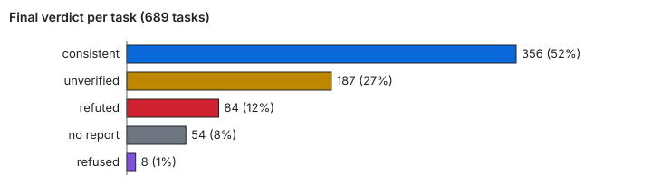
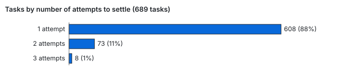
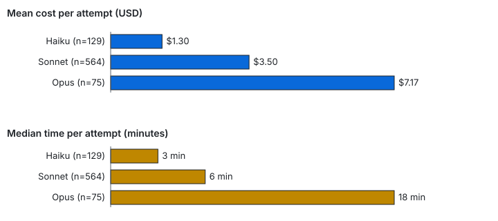
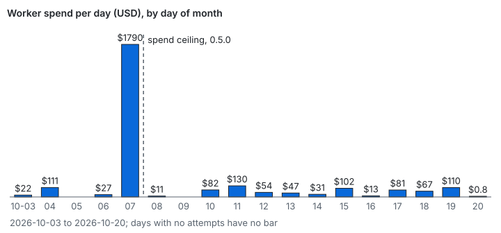
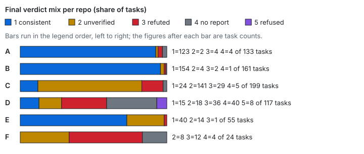
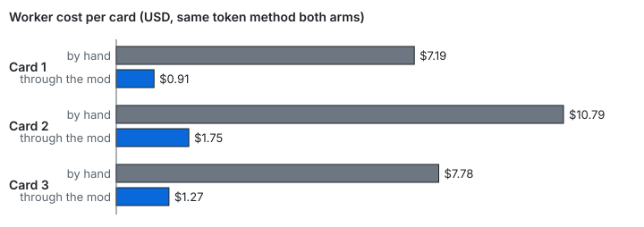

# Evidence

- **689 tasks** across six repos (A to F), 768 judged attempts, from 3 to 20 October 2026.
- **88% settled in one attempt** (608 tasks); 276 tasks were accepted and landed.
- **52% (356 tasks) ended consistent**; consistent means the report matched git, not that the task was right.
- About **$2,677** of worker spend.

Every number comes from [summary.json](evidence/summary.json), the anonymized output of `bin/evidence.mjs` over six ledgers. "Consistent" means the worker's report matches git; it is not a review.

## Final verdict per task



| Verdict | Tasks | Share |
|---|---|---|
| consistent | 356 | 52% |
| unverified | 187 | 27% |
| refuted | 84 | 12% |
| no report | 54 | 8% |
| refused | 8 | 1% |

**Lesson: a refute is the verifier catching a claim git did not back (wrong files, a gate reported green that was red, work outside scope); the 84 are the check working.**

## Attempts to settle



| Attempts | Tasks | Share |
|---|---|---|
| 1 | 608 | 88% |
| 2 | 73 | 11% |
| 3 | 8 | 1% |

**Lesson: most work settles first time; the attempt budget (default 3) caps the rest.**

## Cost and time per tier



| Tier | Attempts | Mean cost | Median | p90 |
|---|---|---|---|---|
| Haiku | 129 | $1.30 | 3 min | 11 min |
| Sonnet | 564 | $3.50 | 6 min | 33 min |
| Opus | 75 | $7.17 | 18 min | 74 min |

**Lesson: Opus costs about five times Haiku per attempt and takes six times as long, so use the cheapest tier that can do the card.**

## Spend per day



| Day (Oct) | 03 | 04 | 06 | 07 | 08 | 10 | 11 | 12 | 13 | 14 | 15 | 16 | 17 | 18 | 19 | 20 |
|---|---|---|---|---|---|---|---|---|---|---|---|---|---|---|---|---|
| USD | 22 | 111 | 27 | 1790 | 11 | 82 | 130 | 54 | 47 | 31 | 102 | 13 | 81 | 67 | 110 | 0.8 |

**Lesson: repo D, on the earliest versions, spent about $1,790 on 7 October with 39 refutes; the spend ceiling shipped in 0.5.0 on 8 October and no day since has passed $131.**

## Verdict mix per repo



| Repo | Tasks | Consistent | Unverified | Refuted | No report | Refused |
|---|---|---|---|---|---|---|
| A | 133 | 123 | 2 | 4 | 4 | 0 |
| B | 161 | 154 | 4 | 2 | 1 | 0 |
| C | 199 | 24 | 141 | 29 | 5 | 0 |
| D | 117 | 15 | 18 | 36 | 40 | 8 |
| E | 55 | 40 | 14 | 1 | 0 | 0 |
| F | 24 | 0 | 8 | 12 | 4 | 0 |

**Lesson: the bad rows have causes, and each one changed the mod.**

- **C:** 141 tasks ended unverified. 121 were one cause: the verifier could not list a folder outside the card's repo (#164), fixed in 0.9.17. Six more were gates that hit the verifier's 9-minute limit (#147), also fixed in 0.9.17.
- **D:** it ran versions 0.1 to 0.6. 40 attempts came back with no report block.
- **F:** it delegated with plain Agent calls and no cards. With no brief there was nothing to check scope or gate against, and none of its 24 tasks came back consistent. Delegate through a card.

## Cost per card, by hand and through the mod



One eval, 3 October 2026: the same three cards built twice. Costs are relative, not invoices.

| Measure | By hand (Opus, steward-driven) | Through the mod (Sonnet, card tier) |
|---|---|---|
| Steward steps per card | about 10 | 0 after the one typed command |
| Worker turns (cards 1/2/3) | 106 / 128 / 103 | 27 / 51 / 37 |
| Worker cost | $7.19 / $10.79 / $7.78 | $0.91 / $1.75 / $1.27 |
| Consistent on first verdict | 3 of 3 | 1 of 3, then 3 of 3 after one follow-up each |
| Diff size, non-test files | +76 / +390 / +144 lines | +36 / +171 / +109 lines |

**Lesson: the mod was cheaper and needed no steering, but two of three cards needed a follow-up; both causes were then fixed (amend blocks now apply before verifying; a load-killed selftest led to scheduling limits).**

## An outside adopter's eight asks

An adopter on a different workflow reviewed the mod. Versions are from [CHANGELOG.md](../CHANGELOG.md); none is still open.

| # | Ask | Shipped in |
|---|---|---|
| 1 | "Consistent" should say it checks the report's honesty, not that the task is right | 0.8.0 |
| 2 | Ad hoc Agent calls bypass verification, budget and ledger | 0.4.0 |
| 3 | Worktree and origin/main are hard requirements | 0.4.0 |
| 4 | "Red test failed first" is unverifiable | 0.4.0 |
| 5 | "Check by hand" gives the brain nothing to act on | 0.4.0 |
| 6 | A malformed budget fails silently | 0.4.0 |
| 7 | Hooks are engine-only | 0.8.0 |
| 8 | Small things: a hardcoded name, a hidden tier rewrite, the classifier on every spawn | 0.4.0 |

## Wins and gaps from 120 debriefs

- **Win:** Sonnet cards with a gate, 11 of 13 consistent first try at about $1.4 to $4.9 each.
- **Wins:** the resource queue kept two workers off one live app; the branch guard stopped a push to main before it happened; hand verification before each merge caught errors the worker missed.
- **Gap, fixed in 0.9.17:** a gate over the 9-minute limit left cards unverified.
- **Gap, fixed in 0.9.17:** a waiting worker woke the brain about ten times in 15 minutes.
- **Gap, fixed in 0.9.17:** polling loops at large context drew cost nudges.
- **Gap, fixed in 0.9.15 to 0.9.17:** store writes vanished across sessions.

53 issues were filed and closed on the public tracker, and 38 tagged releases shipped from 2 to 25 October.

## Reproduce it

Run both on your own ledgers:

```
node bin/evidence.mjs .delegation/ledger.jsonl > summary.json
node bin/evidence-charts.mjs summary.json docs/evidence
```

The hand-versus-mod chart takes its numbers from a constant in `bin/evidence-charts.mjs`, not from the summary.
