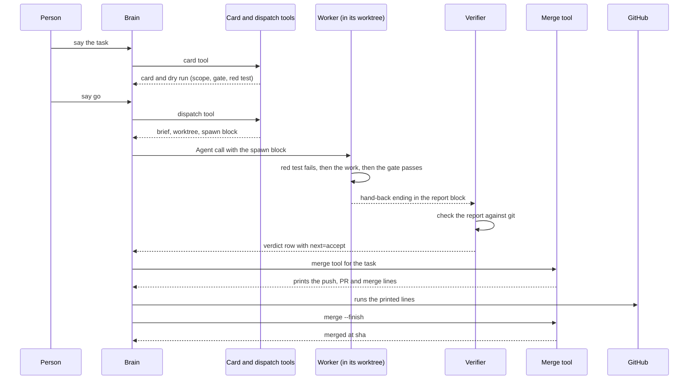
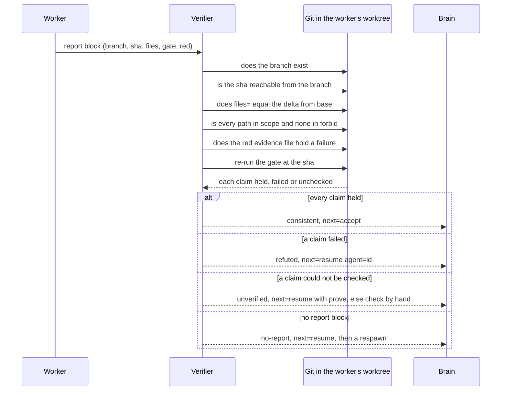
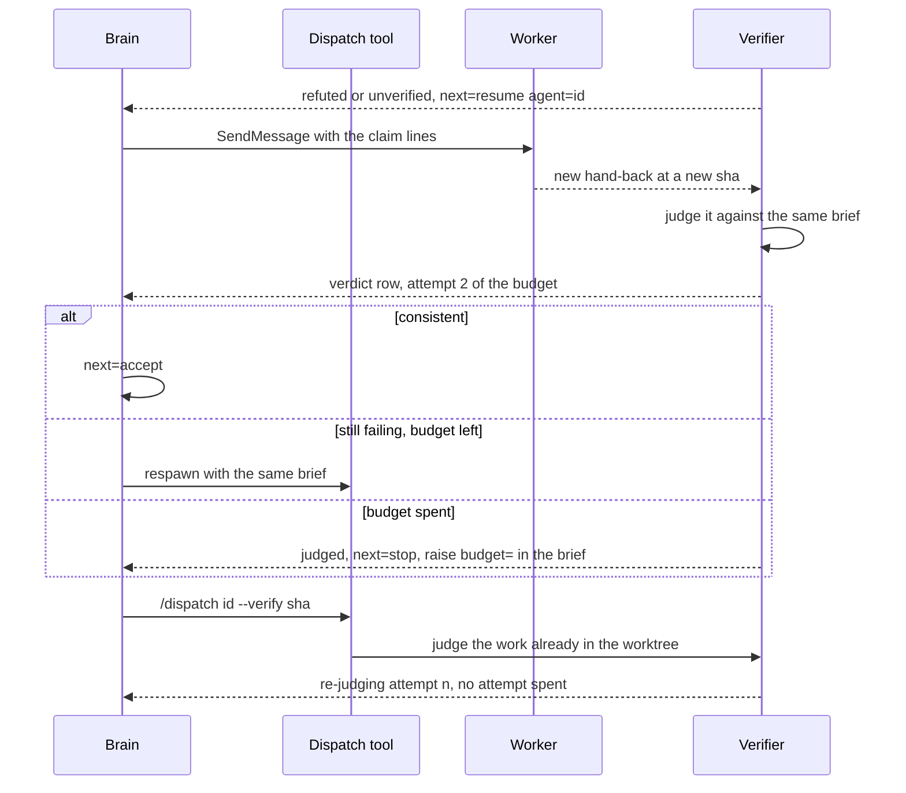
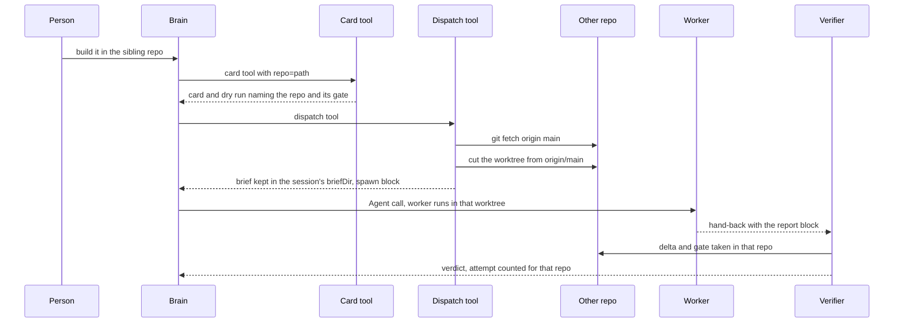

# How it works

Four sequence diagrams show the mod's flow: a card going to merge, what the verifier checks, how a resume spends the attempt budget, and a card for another repo. Each has a plain-text walkthrough beneath it. The reference is in [contracts](contracts.md) and [review and merge](review-and-merge.md).

## Card to merge

*A person's request becomes a card, a brief and a worker, whose report is verified and then merged through GitHub.*

1. The person states the task in a sentence.
2. The brain calls the card tool, which writes the card and prints the dry run.
3. The person says go, and the brain calls the dispatch tool.
4. Dispatch writes the brief, cuts the worktree and prints the spawn block.
5. The brain makes the Agent call with that block, and the worker starts.
6. The worker shows its red test failing, does the work, and runs the gate.
7. It ends its hand-back with the report block.
8. The verifier checks that report against git in the worker's worktree.
9. The verdict row says consistent, with next=accept.
10. The merge tool rebases, commits the merged card, runs the gates and prints the push, PR and merge lines.
11. The brain runs those lines against GitHub.
12. `merge --finish` pulls, removes the worktree and branch, and answers merged at sha.

## What the verifier checks

*The report's claims are each checked against git in the worker's worktree, and the outcome decides the next= advice.*

1. The worker's report names a branch, sha, files, gate and red file.
2. The verifier reads the worker's own worktree with read-only git.
3. The branch must exist.
4. The sha must resolve and be reachable from the branch.
5. The delta from base must equal files= exactly.
6. Every changed path must sit inside scope and outside forbid.
7. The red evidence file must exist and hold the failing run's marker, or be a short file with no marker (2048 bytes or less) that the red test's own run at the head confirms.
8. The gate re-runs only when the tree is clean and HEAD is the sha.
9. All claims held: consistent, and next=accept.
10. Any claim failed: refuted, and next=resume agent=id.
11. A claim unchecked, none failed: unverified, and next=resume with the claims to prove.
12. No report line: no-report, and next=resume, then a respawn.

## Resume and the attempt budget

*A refuted or unverified attempt is resumed or respawned against the same brief until the budget runs out, and a re-verify spends no attempt.*

1. A refuted or unverified verdict advises next=resume agent=id while the budget lasts.
2. The brain sends the worker the claim lines with SendMessage.
3. The worker fixes the work and hands back at a new sha.
4. That resume is the next attempt, and it counts against budget=.
5. The verifier judges it against the same brief: same scope, forbid and gate.
6. Consistent: the advice is accept.
7. Still failing with budget left: the advice is a resume, later a respawn.
8. The budget is spent: the attempt is still judged, but the advice is next=stop. Raise budget= in the brief and the ladder resumes from that attempt, with the brief re-read.
9. For finished work or a missing verdict, `/dispatch <id> --verify <sha>` runs the verifier with no spawn.
10. It re-judges the same attempt, and no attempt is spent.

## A card for another repo

*A card with repo set to another checkout is cut, briefed, verified and counted in that repo, while its brief stays with the session.*

1. The brain calls the card tool with repo set to the absolute path of the other checkout.
2. The card tool's dry run names that repo, its config and the gate it will use.
3. On the dispatch tool call, dispatch fetches that repo's origin/main and cuts the worktree from it.
4. The brief stays in the session's briefDir, and its header carries repo=path.
5. The worker runs in the other repo's worktree.
6. The verifier takes the delta and runs the gate in that worktree.
7. Attempts are counted per repo, so the same task id in two repos does not share a budget.

See also: [how a report is verified](contracts.md#how-a-report-is-verified), [delegating into another repo](contracts.md#delegating-into-another-repo) and [merging a card](review-and-merge.md#merging-a-card).
